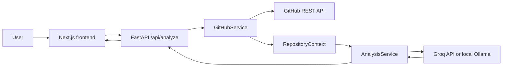

# RepoLens

RepoLens is an AI-powered onboarding guide for public GitHub repositories. It retrieves repository metadata, README content, a bounded file tree, and a small curated sample of project/source files, then produces practical first steps and engineering insights with source excerpts verified against the retrieved files.

## Live Demo

[Open RepoLens](https://repo-lens-ai-42.vercel.app/)

## What It Does

- Validates public GitHub repository URLs without fetching arbitrary websites.
- Retrieves repository metadata, language breakdown, README, recursive file tree, and selected source/configuration files through GitHub's REST API.
- Bounds README to 20,000 characters, the file tree to 500 entries, and source context to 12 files / 60 KB.
- Extracts setup, run, test, and build commands directly from `package.json` scripts, Makefiles, `pyproject.toml`, lockfiles, and README shell blocks, with links to the exact line. No AI is involved in this step.
- Detects likely entry points from file names and package manifests.
- Generates a reading order, first steps, architecture overview, and repository-specific recommendations with an AI model.
- Verifies every quote and file path the model returns against the retrieved files. Recommendations without a matching quote are labeled as unverified, and invented paths are dropped.
- Lists open questions the model could not answer and reports exactly which files were and were not inspected.
- Labels each section as either taken from the repository or AI generated.

## Architecture



The backend keeps responsibilities separate:

```text
API route → GitHubService → RepositoryContext → AnalysisService → Pydantic response
```

## Tech Stack

- Frontend: Next.js 16, React, TypeScript
- Backend: FastAPI, Pydantic, HTTPX
- Repository data: GitHub REST API
- AI: Groq (hosted) or Ollama-compatible local model
- Testing: Pytest with mocked GitHub and Ollama responses

## How It Works

1. The user submits a URL such as `https://github.com/vercel/next.js`.
2. FastAPI validates and parses the owner and repository name.
3. `GitHubService` retrieves repository metadata, languages, README, file-tree entries, and selected source files.
4. The service creates a bounded `RepositoryContext`:
   - README is limited to 20,000 characters.
   - File tree is limited to 500 entries.
   - Up to 12 high-value setup, entry-point, route, and test files are selected, capped at 12 KB each and 60 KB total.
5. `AnalysisService` requests an evidence-based onboarding guide, validates the result with Pydantic, and checks source quotes before attaching line numbers.
6. The frontend displays repository facts, first steps, recommendations, and links to verified source evidence.

## Local Development

### Prerequisites

- Python 3.11 or newer
- Node.js 20 or newer
- [Ollama](https://ollama.com/) running locally

### 1. Start Ollama

In one PowerShell terminal:

```powershell
ollama pull llama3.2:1b
ollama serve
```

If Ollama is already running as a desktop service, only the `ollama pull` command is needed.

### 2. Start the backend

In a second terminal (PowerShell or bash):

Windows (PowerShell):

```powershell
cd backend
python -m venv .venv
.\.venv\Scripts\Activate.ps1
pip install -r requirements.txt
Copy-Item .env.example .env
uvicorn src.main:app --reload --port 8000
```

macOS / Linux (bash):

```bash
cd backend
python3 -m venv .venv
source .venv/bin/activate
pip install -r requirements.txt
cp .env.example .env
uvicorn src.main:app --reload --port 8000
```

### 3. Start the frontend

In a third terminal (PowerShell or bash):

Windows (PowerShell):

```powershell
cd frontend
Copy-Item .env.local.example .env.local
npm ci
npm run dev
```

macOS / Linux (bash):

```bash
cd frontend
cp .env.local.example .env.local
npm ci
npm run dev
```

Open http://localhost:3000 in your browser, then analyze a public repository such as:

```text
https://github.com/vercel/next.js
```

## Environment Variables

Backend variables are loaded from `backend/.env`.

| Variable | Required | Default | Purpose |
| --- | --- | --- | --- |
| `GITHUB_TOKEN` | No | — | Raises GitHub API rate limits for public repositories. Never expose this to the frontend. |
| `AI_PROVIDER` | No | auto-detect | Set to `groq`, `openai`, or `ollama`. Use `groq` for the hosted free-tier setup. |
| `GROQ_API_KEY` | Groq only | — | Groq API key. Store it only in the backend host's secret environment variables. |
| `GROQ_MODEL` | No | `openai/gpt-oss-20b` | Groq model used for analysis. |
| `OLLAMA_BASE_URL` | No | `http://localhost:11434` | Ollama API address. |
| `OLLAMA_MODEL` | No | `llama3.2:1b` | Local model used for analysis. |
| `ANALYSIS_TIMEOUT_SECONDS` | No | `120` | Maximum total time allowed for one model analysis. |
| `AI_MAX_PROMPT_CHARS` | No | `10000` | Character budget for the README, file tree, and source files sent to the model. Commands and entry points are always included. |
| `AI_MAX_OUTPUT_TOKENS` | No | `3500` | Maximum tokens the model may generate, including hidden reasoning for `gpt-oss` models. Together with the prompt this must fit the provider's per-request limit (about 8K tokens on Groq's free tier for `openai/gpt-oss-20b`). |
| `AI_REASONING_EFFORT` | No | `low` | Reasoning effort sent to `gpt-oss` models. Low leaves more of the output budget for the answer; set it empty to omit the parameter. |

Frontend variables are loaded from `frontend/.env.local`.

| Variable | Required | Default | Purpose |
| --- | --- | --- | --- |
| `NEXT_PUBLIC_API_BASE_URL` | Production only | Local: `http://127.0.0.1:8000` | Backend API base URL, for example `https://repo-lens-tdpr.onrender.com`. Production builds show a configuration error when it is missing. |

## Deployment

RepoLens uses Vercel for the Next.js frontend and Render for the FastAPI API. Production analysis uses Groq's hosted API, so Render does not need to run Ollama or attach a persistent disk.

### Deploy the API on Render

1. Create a **Web Service** from this GitHub repository and choose the **Docker** runtime.
2. Use these build settings:

   ```text
   Root Directory: backend
   Dockerfile Path: Dockerfile
   Docker Build Context Directory: .
   ```

   The included `render.yaml` contains the same settings if you prefer a Render Blueprint.

3. Add the following environment variables:

   ```text
   AI_PROVIDER=groq
   GROQ_API_KEY=<your Groq API key>
   GROQ_MODEL=openai/gpt-oss-20b
   CORS_ORIGINS=https://repo-lens-ai-42.vercel.app,https://frontend-omega-sepia-42.vercel.app
   GITHUB_TOKEN=<optional GitHub token>
   ```

4. Deploy and verify `https://<your-render-service>.onrender.com/health` returns `{"status":"ok"}`.

### Deploy the frontend on Vercel

1. Import the same repository into Vercel and set **Root Directory** to `frontend`.
2. Add this production environment variable, using the public URL of the Render API:

   ```text
   NEXT_PUBLIC_API_BASE_URL=https://<your-render-service>.onrender.com
   ```

3. Deploy the project. When the API URL changes, update `NEXT_PUBLIC_API_BASE_URL` and redeploy Vercel. If the frontend URL changes, update Render's `CORS_ORIGINS` value and redeploy Render.

For local development, set `AI_PROVIDER=ollama` and use the Ollama settings in `backend/.env.example`.

If analysis fails in the deployed site, open the API health URL (`https://<your-render-service>.onrender.com/health`). It should return `{"status":"ok"}`. A browser `NetworkError` can mean the API is unavailable, the frontend is using the wrong `NEXT_PUBLIC_API_BASE_URL`, or the API's `CORS_ORIGINS` does not include the exact Vercel site origin. Vercel can redirect one domain to another (for example `frontend-omega-sepia-42.vercel.app` to `repo-lens-ai-42.vercel.app`), so list every domain the site is served from. After changing Render environment settings, redeploy the API; after changing the frontend API URL, redeploy Vercel.

## Testing

Run backend tests without a live GitHub or Ollama server (from the repository root):

Windows (PowerShell):

```powershell
cd backend
.\.venv\Scripts\python.exe -m pytest -q tests -p no:cacheprovider
```

macOS / Linux (bash):

```bash
cd backend
source .venv/bin/activate
python -m pytest -q tests -p no:cacheprovider
```

Type-check the frontend (from the `frontend` folder):

```bash
cd frontend
npx tsc --noEmit
```

## Future Roadmap

- Persist analysis history after selecting an appropriate database workflow.
- GitHub OAuth for private repository access.
- Repository chat and source-aware retrieval.
- Pull-request and commit analysis.
- Specialized security, quality, and documentation insights.

These are intentionally outside the current repository-intelligence MVP.
